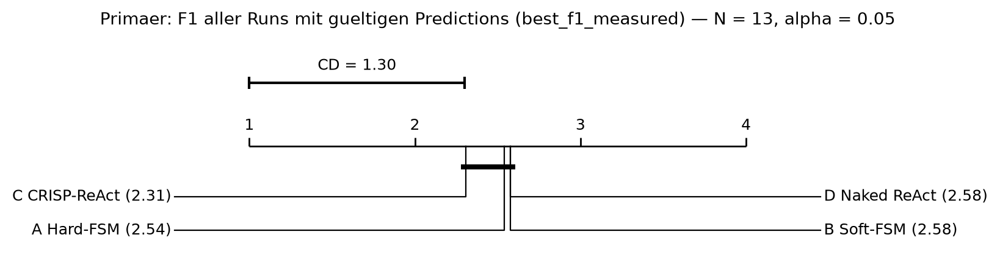
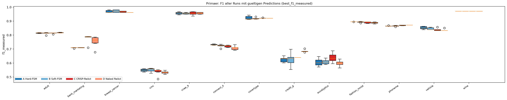
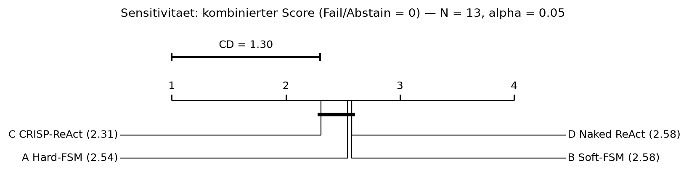
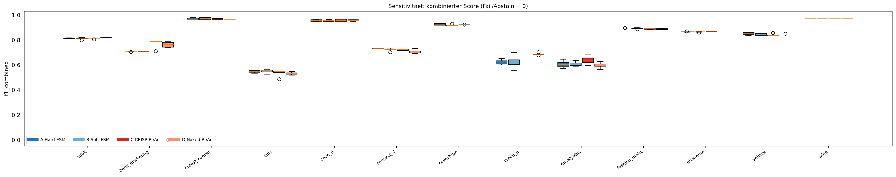
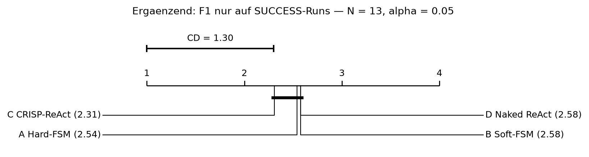
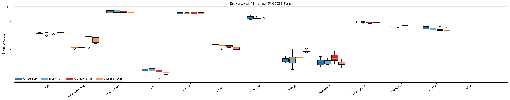

# Auswertung Haupt-Runs

Quelle `main_runs.json` · Modell claude-opus-4-8 · n-Soll 6 · Zellwert = median · alpha = 0.05

## Stand der Daten

| Arm | gemessen | offen | kontaminiert | Kosten $ |
|---|---|---|---|---|
| A Hard-FSM | 78 | 0 | 0 | 92.40 |
| B Soft-FSM | 78 | 0 | 0 | 129.44 |
| C CRISP-ReAct | 78 | 0 | 0 | 19.80 |
| D Naked ReAct | 78 | 0 | 0 | 10.30 |

## Stufe 1 — Bestanden (SUCCESS-Rate, Wilson 95 %)

SUCCESS = vollstaendig durchgelaufen, gueltige Predictions, auf denselben Test-Zeilen nicht signifikant schlechter als die Default-Baseline (gepaarter Bootstrap, 95 %).

| Arm | SUCCESS / n | Rate | Wilson-KI |
|---|---|---|---|
| A Hard-FSM | 78 / 78 | 1.000 | [0.953, 1.000] |
| B Soft-FSM | 78 / 78 | 1.000 | [0.953, 1.000] |
| C CRISP-ReAct | 78 / 78 | 1.000 | [0.953, 1.000] |
| D Naked ReAct | 77 / 78 | 0.987 | [0.931, 0.998] |

| Paar (Fisher exact, gepoolt) | Tabelle [[S,F],[S,F]] | OR | p |
|---|---|---|---|
| A Hard-FSM vs B Soft-FSM | [[78, 0], [78, 0]] | — | 1.000 |
| A Hard-FSM vs C CRISP-ReAct | [[78, 0], [78, 0]] | — | 1.000 |
| A Hard-FSM vs D Naked ReAct | [[78, 0], [77, 1]] | inf | 1.000 |
| B Soft-FSM vs C CRISP-ReAct | [[78, 0], [78, 0]] | — | 1.000 |
| B Soft-FSM vs D Naked ReAct | [[78, 0], [77, 1]] | inf | 1.000 |
| C CRISP-ReAct vs D Naked ReAct | [[78, 0], [77, 1]] | inf | 1.000 |

### fail_reason pro Zelle (nur Zellen mit Nicht-SUCCESS)

| Dataset | Arm | SUCCESS / n | fail_reasons |
|---|---|---|---|
| bank_marketing | D Naked ReAct | 5 / 6 | below_threshold 1 |

# Stufe 2 — Qualitaet (Friedman + Nemenyi auf F1)

## Primaer: F1 aller Runs mit gueltigen Predictions (best_f1_measured)

**Friedman:** chi2 = 0.39 (df 3), p = 0.942 · **Iman-Davenport:** F(3, 36) = 0.12, p = 0.947 · N = 13, k = 4, **CD = 1.30**

| Arm | mittlerer Rang |
|---|---|
| C CRISP-ReAct | 2.31 |
| A Hard-FSM | 2.54 |
| B Soft-FSM | 2.58 |
| D Naked ReAct | 2.58 |

| Paar | Rang-Diff | Nemenyi sig. | Cliff's δ (Mittel) | Magnitude | large a>b / b>a |
|---|---|---|---|---|---|
| A Hard-FSM vs B Soft-FSM | 0.04 | nein | 0.075 | negligible | 1 / 0 |
| A Hard-FSM vs C CRISP-ReAct | 0.23 | nein | -0.004 | negligible | 3 / 4 |
| A Hard-FSM vs D Naked ReAct | 0.04 | nein | 0.017 | negligible | 4 / 3 |
| B Soft-FSM vs C CRISP-ReAct | 0.27 | nein | -0.068 | negligible | 2 / 4 |
| B Soft-FSM vs D Naked ReAct | 0.00 | nein | -0.019 | negligible | 5 / 5 |
| C CRISP-ReAct vs D Naked ReAct | 0.27 | nein | 0.130 | negligible | 3 / 2 |

| Dataset | A Hard-FSM | B Soft-FSM | C CRISP-ReAct | D Naked ReAct |
|---|---|---|---|---|
| adult | 0.816 | 0.815 | 0.815 | **0.816** |
| bank_marketing | 0.711 | 0.710 | **0.788** | 0.764 |
| breast_cancer | 0.962 | **0.971** | 0.967 | 0.962 |
| cmc | 0.550 | **0.557** | 0.549 | 0.535 |
| cnae_9 | 0.959 | 0.956 | 0.956 | **0.959** |
| connect_4 | **0.730** | 0.726 | 0.724 | 0.712 |
| covertype | 0.916 | 0.917 | **0.921** | **0.921** |
| credit_g | 0.631 | 0.633 | 0.640 | **0.682** |
| eucalyptus | 0.602 | 0.607 | **0.633** | 0.600 |
| fashion_mnist | **0.895** | 0.895 | 0.894 | 0.889 |
| phoneme | 0.865 | 0.866 | 0.870 | **0.872** |
| vehicle | **0.851** | 0.839 | 0.835 | 0.832 |
| wine | **0.971** | **0.971** | **0.971** | **0.971** |

## Sensitivitaet: kombinierter Score (Fail/Abstain = 0)

**Friedman:** chi2 = 0.39 (df 3), p = 0.942 · **Iman-Davenport:** F(3, 36) = 0.12, p = 0.947 · N = 13, k = 4, **CD = 1.30**

| Arm | mittlerer Rang |
|---|---|
| C CRISP-ReAct | 2.31 |
| A Hard-FSM | 2.54 |
| B Soft-FSM | 2.58 |
| D Naked ReAct | 2.58 |

| Paar | Rang-Diff | Nemenyi sig. | Cliff's δ (Mittel) | Magnitude | large a>b / b>a |
|---|---|---|---|---|---|
| A Hard-FSM vs B Soft-FSM | 0.04 | nein | 0.075 | negligible | 1 / 0 |
| A Hard-FSM vs C CRISP-ReAct | 0.23 | nein | -0.004 | negligible | 3 / 4 |
| A Hard-FSM vs D Naked ReAct | 0.04 | nein | 0.017 | negligible | 4 / 3 |
| B Soft-FSM vs C CRISP-ReAct | 0.27 | nein | -0.068 | negligible | 2 / 4 |
| B Soft-FSM vs D Naked ReAct | 0.00 | nein | -0.019 | negligible | 5 / 5 |
| C CRISP-ReAct vs D Naked ReAct | 0.27 | nein | 0.130 | negligible | 3 / 2 |

| Dataset | A Hard-FSM | B Soft-FSM | C CRISP-ReAct | D Naked ReAct |
|---|---|---|---|---|
| adult | 0.816 | 0.815 | 0.815 | **0.816** |
| bank_marketing | 0.711 | 0.710 | **0.788** | 0.764 |
| breast_cancer | 0.962 | **0.971** | 0.967 | 0.962 |
| cmc | 0.550 | **0.557** | 0.549 | 0.535 |
| cnae_9 | 0.959 | 0.956 | 0.956 | **0.959** |
| connect_4 | **0.730** | 0.726 | 0.724 | 0.712 |
| covertype | 0.916 | 0.917 | **0.921** | **0.921** |
| credit_g | 0.631 | 0.633 | 0.640 | **0.682** |
| eucalyptus | 0.602 | 0.607 | **0.633** | 0.600 |
| fashion_mnist | **0.895** | 0.895 | 0.894 | 0.889 |
| phoneme | 0.865 | 0.866 | 0.870 | **0.872** |
| vehicle | **0.851** | 0.839 | 0.835 | 0.832 |
| wine | **0.971** | **0.971** | **0.971** | **0.971** |

## Ergaenzend: F1 nur auf SUCCESS-Runs

**Friedman:** chi2 = 0.39 (df 3), p = 0.942 · **Iman-Davenport:** F(3, 36) = 0.12, p = 0.947 · N = 13, k = 4, **CD = 1.30**

| Arm | mittlerer Rang |
|---|---|
| C CRISP-ReAct | 2.31 |
| A Hard-FSM | 2.54 |
| B Soft-FSM | 2.58 |
| D Naked ReAct | 2.58 |

| Paar | Rang-Diff | Nemenyi sig. | Cliff's δ (Mittel) | Magnitude | large a>b / b>a |
|---|---|---|---|---|---|
| A Hard-FSM vs B Soft-FSM | 0.04 | nein | 0.075 | negligible | 1 / 0 |
| A Hard-FSM vs C CRISP-ReAct | 0.23 | nein | -0.004 | negligible | 3 / 4 |
| A Hard-FSM vs D Naked ReAct | 0.04 | nein | -0.009 | negligible | 4 / 3 |
| B Soft-FSM vs C CRISP-ReAct | 0.27 | nein | -0.068 | negligible | 2 / 4 |
| B Soft-FSM vs D Naked ReAct | 0.00 | nein | -0.045 | negligible | 5 / 5 |
| C CRISP-ReAct vs D Naked ReAct | 0.27 | nein | 0.125 | negligible | 3 / 2 |

| Dataset | A Hard-FSM | B Soft-FSM | C CRISP-ReAct | D Naked ReAct |
|---|---|---|---|---|
| adult | 0.816 | 0.815 | 0.815 | **0.816** |
| bank_marketing | 0.711 | 0.710 | **0.788** | 0.780 |
| breast_cancer | 0.962 | **0.971** | 0.967 | 0.962 |
| cmc | 0.550 | **0.557** | 0.549 | 0.535 |
| cnae_9 | 0.959 | 0.956 | 0.956 | **0.959** |
| connect_4 | **0.730** | 0.726 | 0.724 | 0.712 |
| covertype | 0.916 | 0.917 | **0.921** | **0.921** |
| credit_g | 0.631 | 0.633 | 0.640 | **0.682** |
| eucalyptus | 0.602 | 0.607 | **0.633** | 0.600 |
| fashion_mnist | **0.895** | 0.895 | 0.894 | 0.889 |
| phoneme | 0.865 | 0.866 | 0.870 | **0.872** |
| vehicle | **0.851** | 0.839 | 0.835 | 0.832 |
| wine | **0.971** | **0.971** | **0.971** | **0.971** |

## Run-SD (f1_measured) — Stabilitaet als AV

| Arm | Median-SD | Max-SD | Zellen |
|---|---|---|---|
| A Hard-FSM | 0.0088 | 0.0280 | 13 |
| B Soft-FSM | 0.0078 | 0.0486 | 13 |
| C CRISP-ReAct | 0.0053 | 0.0336 | 13 |
| D Naked ReAct | 0.0067 | 0.0414 | 13 |
