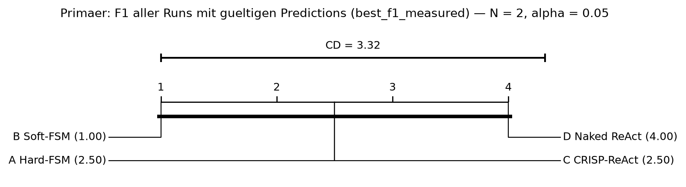
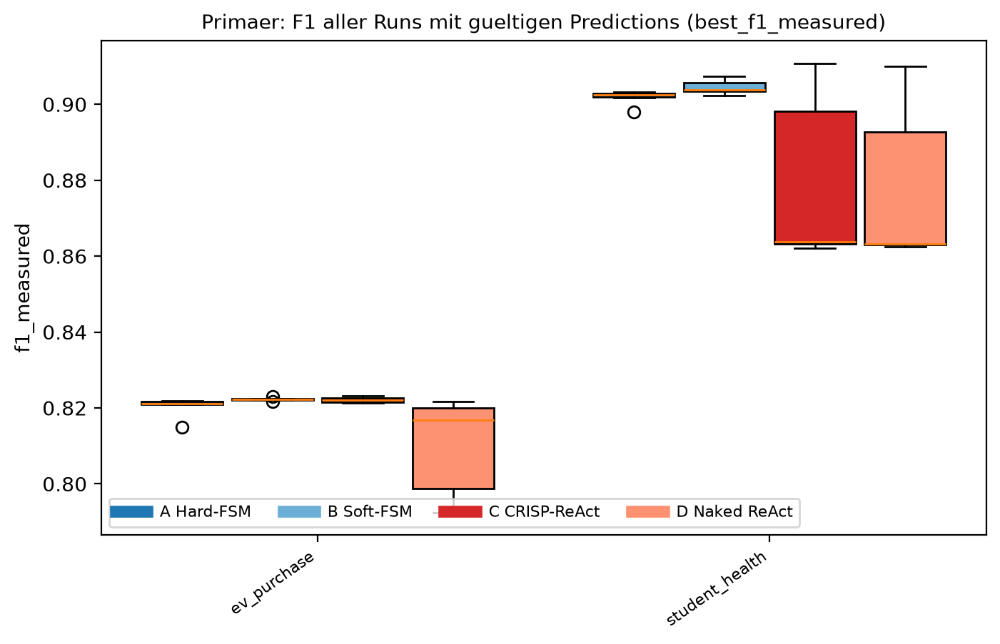
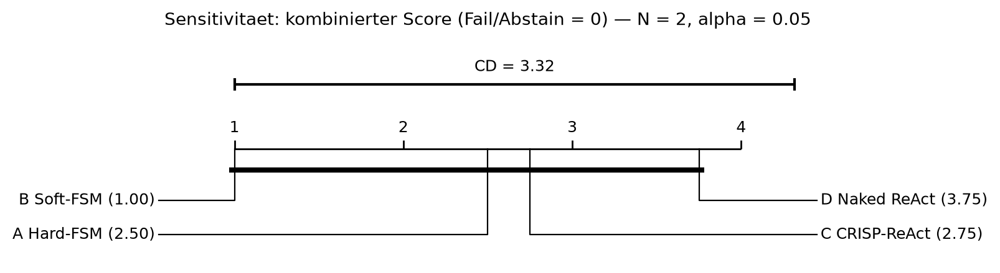
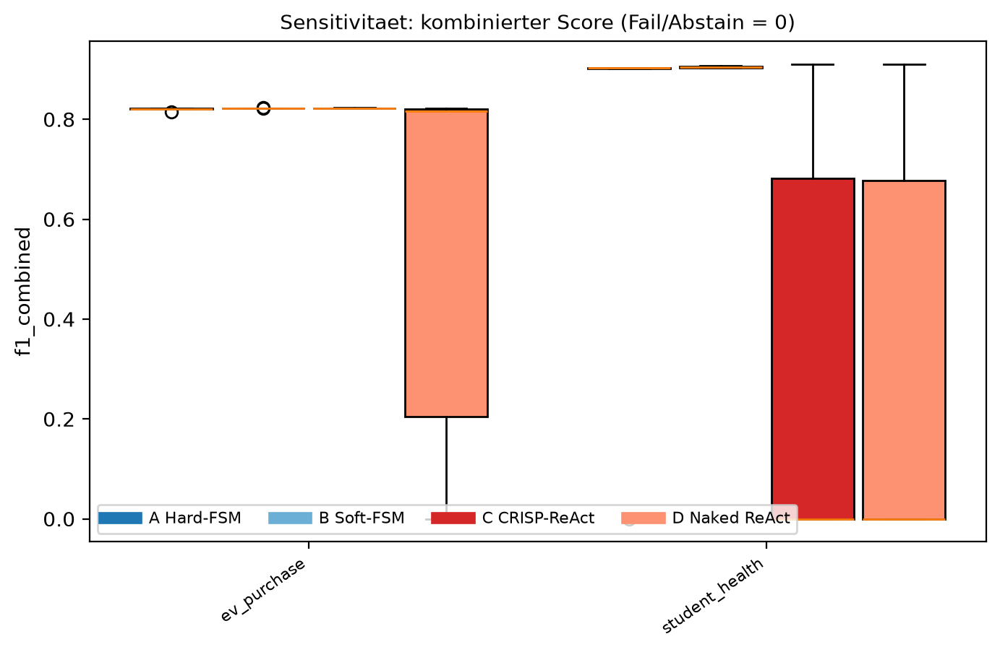
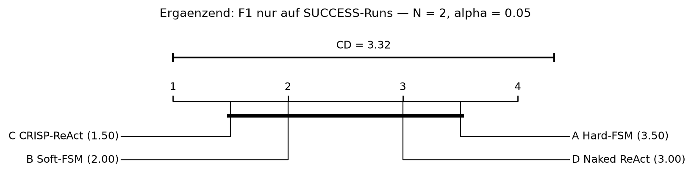
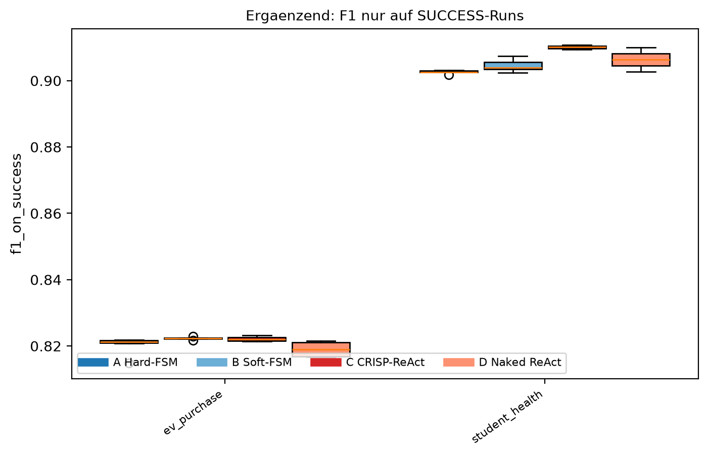

# Auswertung Haupt-Runs

Quelle `main_runs.json` · Modell claude-opus-4-8 · n-Soll 6 · Zellwert = median · alpha = 0.05

## Stand der Daten

| Arm | gemessen | offen | kontaminiert | Kosten $ |
|---|---|---|---|---|
| A Hard-FSM | 12 | 0 | 0 | 15.03 |
| B Soft-FSM | 12 | 0 | 0 | 22.08 |
| C CRISP-ReAct | 12 | 0 | 0 | 3.31 |
| D Naked ReAct | 12 | 0 | 0 | 1.52 |

## Stufe 1 — Bestanden (SUCCESS-Rate, Wilson 95 %)

SUCCESS = vollstaendig durchgelaufen, gueltige Predictions, auf denselben Test-Zeilen nicht signifikant schlechter als die Default-Baseline (gepaarter Bootstrap, 95 %).

| Arm | SUCCESS / n | Rate | Wilson-KI |
|---|---|---|---|
| A Hard-FSM | 11 / 12 | 0.917 | [0.646, 0.985] |
| B Soft-FSM | 12 / 12 | 1.000 | [0.757, 1.000] |
| C CRISP-ReAct | 8 / 12 | 0.667 | [0.391, 0.862] |
| D Naked ReAct | 6 / 12 | 0.500 | [0.254, 0.746] |

| Paar (Fisher exact, gepoolt) | Tabelle [[S,F],[S,F]] | OR | p |
|---|---|---|---|
| A Hard-FSM vs B Soft-FSM | [[11, 1], [12, 0]] | 0.00 | 1.000 |
| A Hard-FSM vs C CRISP-ReAct | [[11, 1], [8, 4]] | 5.50 | 0.317 |
| A Hard-FSM vs D Naked ReAct | [[11, 1], [6, 6]] | 11.00 | 0.069 |
| B Soft-FSM vs C CRISP-ReAct | [[12, 0], [8, 4]] | inf | 0.093 |
| B Soft-FSM vs D Naked ReAct | [[12, 0], [6, 6]] | inf | 0.014 |
| C CRISP-ReAct vs D Naked ReAct | [[8, 4], [6, 6]] | 2.00 | 0.680 |

### fail_reason pro Zelle (nur Zellen mit Nicht-SUCCESS)

| Dataset | Arm | SUCCESS / n | fail_reasons |
|---|---|---|---|
| ev_purchase | D Naked ReAct | 4 / 6 | below_threshold 2 |
| student_health | A Hard-FSM | 5 / 6 | below_threshold 1 |
| student_health | C CRISP-ReAct | 2 / 6 | below_threshold 4 |
| student_health | D Naked ReAct | 2 / 6 | below_threshold 4 |

# Stufe 2 — Qualitaet (Friedman + Nemenyi auf F1)

## Primaer: F1 aller Runs mit gueltigen Predictions (best_f1_measured)

**Friedman:** chi2 = 5.40 (df 3), p = 0.145 · **Iman-Davenport:** F(3, 3) = 9.00, p = 0.052 · N = 2, k = 4, **CD = 3.32**

| Arm | mittlerer Rang |
|---|---|
| B Soft-FSM | 1.00 |
| A Hard-FSM | 2.50 |
| C CRISP-ReAct | 2.50 |
| D Naked ReAct | 4.00 |

| Paar | Rang-Diff | Nemenyi sig. | Cliff's δ (Mittel) | Magnitude | large a>b / b>a |
|---|---|---|---|---|---|
| A Hard-FSM vs B Soft-FSM | 1.50 | nein | -0.833 | large | 0 / 2 |
| A Hard-FSM vs C CRISP-ReAct | 0.00 | nein | -0.139 | negligible | 0 / 1 |
| A Hard-FSM vs D Naked ReAct | 1.50 | nein | 0.472 | medium | 1 / 0 |
| B Soft-FSM vs C CRISP-ReAct | 1.50 | nein | 0.222 | small | 0 / 0 |
| B Soft-FSM vs D Naked ReAct | 3.00 | nein | 0.806 | large | 2 / 0 |
| C CRISP-ReAct vs D Naked ReAct | 1.50 | nein | 0.528 | large | 1 / 0 |

| Dataset | A Hard-FSM | B Soft-FSM | C CRISP-ReAct | D Naked ReAct |
|---|---|---|---|---|
| ev_purchase | 0.821 | **0.822** | 0.822 | 0.817 |
| student_health | 0.903 | **0.904** | 0.864 | 0.863 |

## Sensitivitaet: kombinierter Score (Fail/Abstain = 0)

**Friedman:** chi2 = 4.65 (df 3), p = 0.199 · **Iman-Davenport:** F(3, 3) = 3.44, p = 0.168 · N = 2, k = 4, **CD = 3.32**

| Arm | mittlerer Rang |
|---|---|
| B Soft-FSM | 1.00 |
| A Hard-FSM | 2.50 |
| C CRISP-ReAct | 2.75 |
| D Naked ReAct | 3.75 |

| Paar | Rang-Diff | Nemenyi sig. | Cliff's δ (Mittel) | Magnitude | large a>b / b>a |
|---|---|---|---|---|---|
| A Hard-FSM vs B Soft-FSM | 1.50 | nein | -0.833 | large | 0 / 2 |
| A Hard-FSM vs C CRISP-ReAct | 0.25 | nein | -0.194 | small | 0 / 1 |
| A Hard-FSM vs D Naked ReAct | 1.25 | nein | 0.417 | medium | 1 / 0 |
| B Soft-FSM vs C CRISP-ReAct | 1.75 | nein | 0.222 | small | 0 / 0 |
| B Soft-FSM vs D Naked ReAct | 2.75 | nein | 0.806 | large | 2 / 0 |
| C CRISP-ReAct vs D Naked ReAct | 1.00 | nein | 0.472 | medium | 1 / 0 |

| Dataset | A Hard-FSM | B Soft-FSM | C CRISP-ReAct | D Naked ReAct |
|---|---|---|---|---|
| ev_purchase | 0.821 | **0.822** | 0.822 | 0.817 |
| student_health | 0.903 | **0.904** | 0.000 | 0.000 |

## Ergaenzend: F1 nur auf SUCCESS-Runs

**Friedman:** chi2 = 3.00 (df 3), p = 0.392 · **Iman-Davenport:** F(3, 3) = 1.00, p = 0.500 · N = 2, k = 4, **CD = 3.32**

| Arm | mittlerer Rang |
|---|---|
| C CRISP-ReAct | 1.50 |
| B Soft-FSM | 2.00 |
| D Naked ReAct | 3.00 |
| A Hard-FSM | 3.50 |

| Paar | Rang-Diff | Nemenyi sig. | Cliff's δ (Mittel) | Magnitude | large a>b / b>a |
|---|---|---|---|---|---|
| A Hard-FSM vs B Soft-FSM | 1.50 | nein | -0.811 | large | 0 / 2 |
| A Hard-FSM vs C CRISP-ReAct | 2.00 | nein | -0.806 | large | 0 / 2 |
| A Hard-FSM vs D Naked ReAct | 0.50 | nein | -0.175 | small | 0 / 1 |
| B Soft-FSM vs C CRISP-ReAct | 0.50 | nein | -0.444 | medium | 0 / 1 |
| B Soft-FSM vs D Naked ReAct | 1.00 | nein | 0.417 | medium | 1 / 0 |
| C CRISP-ReAct vs D Naked ReAct | 1.50 | nein | 0.667 | large | 2 / 0 |

| Dataset | A Hard-FSM | B Soft-FSM | C CRISP-ReAct | D Naked ReAct |
|---|---|---|---|---|
| ev_purchase | 0.821 | **0.822** | 0.822 | 0.819 |
| student_health | 0.903 | 0.904 | **0.910** | 0.906 |

## Run-SD (f1_measured) — Stabilitaet als AV

| Arm | Median-SD | Max-SD | Zellen |
|---|---|---|---|
| A Hard-FSM | 0.0023 | 0.0027 | 2 |
| B Soft-FSM | 0.0012 | 0.0019 | 2 |
| C CRISP-ReAct | 0.0125 | 0.0242 | 2 |
| D Naked ReAct | 0.0182 | 0.0225 | 2 |
